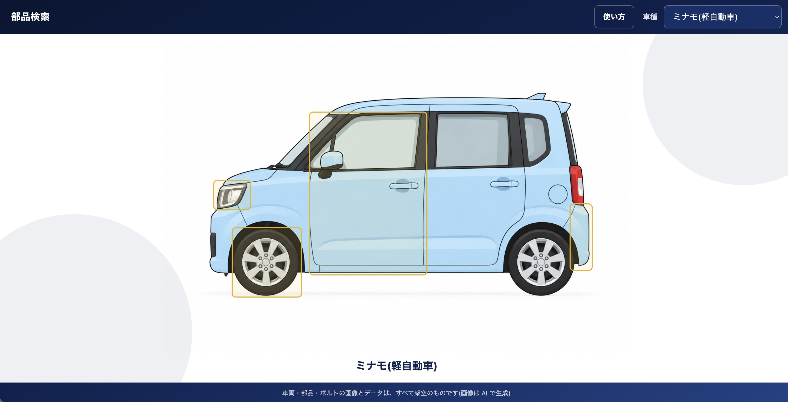
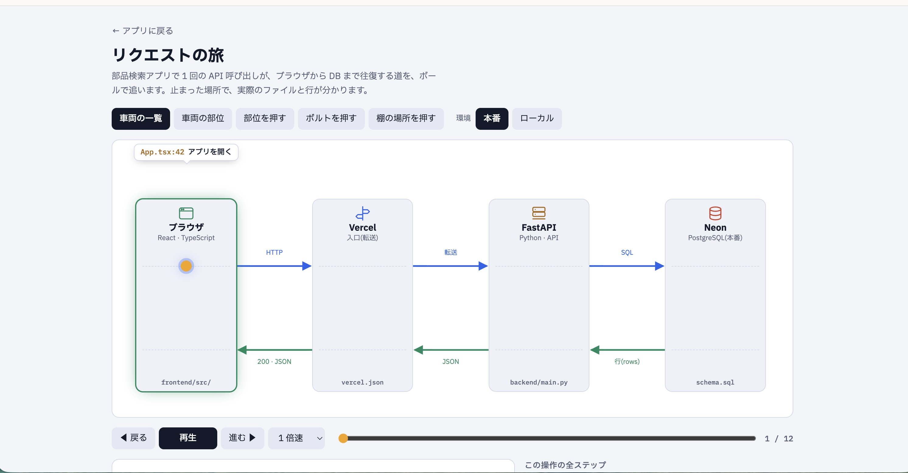
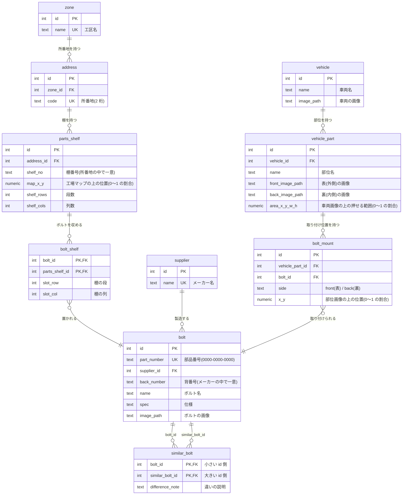

# factory-parts-finder

自動車製造ラインの部品(ボルト・ナット)検索アプリ

**公開中**: https://factory-parts-finder.vercel.app (iPad の横向きを基準にした画面です)

## できること

車両の画像を押して絞り込み、ボルトの置き場所を工場マップで確かめられます。

最初に開いたときは、アプリの概要・想定機器・「リクエストの旅」の紹介・注記を載せた案内のポップアップが出ます。「部品検索を始める」を押すと(閉じても同じ)、画面の上に、押す場所の枠・番号・短いコメントで操作を案内するガイドが、初回だけ始まります。ヘッダーの「使い方」で、いつでも見直せます。



1. ヘッダーの「車種」で、車両を選ぶ(「ミナモ(軽自動車)」と「ツキカゲ(セダン)」)
2. 車両の画像の上の、部位を押す(ミナモ: 左ヘッドランプ、左 F/D、ホイール、Rr バンパー / ツキカゲ: 左 F/D アウターハンドル、左テールランプ)
3. 部位のポップアップが開く。「表(外側)」「裏(内側)」を切り替えて、ボルトの印を押す
4. 右のパネルに、ボルトの情報(名前、部品番号、メーカー)、置かれている部品棚の表、類似ボルト(違いの説明つき)が出る
5. 部品棚の表の行を押すと、工場マップが開く。ボルトが置かれている棚に印がつき、印を押すと、右に棚の絵(段 × 列と、ボルトの位置)が出る

ポップアップは、右上の「✕」、背景、Esc のどれでも閉じられます。工場マップを閉じると、ボルトのポップアップに戻ります。

## 構成

- `frontend/` 画面(React + TypeScript + Tailwind CSS)
- `backend/` API(Python + FastAPI)と、データベースのテーブル定義(`schema.sql`)・ダミーデータ(`seed.sql`)
- 公開先: Vercel(画面と API)+ Neon(PostgreSQL)

## API

閲覧専用の API が **5 つ**あります(データの登録・変更・削除はできません)。
API の説明ページ(FastAPI の自動生成)は、`/api/docs` で見られます。

| API | 役割 |
|---|---|
| `GET /api/vehicles` | 車両の一覧 |
| `GET /api/vehicles/{id}/parts` | 車両の部位の一覧と、車両画像の上の押せる範囲 |
| `GET /api/vehicle-parts/{id}` | 部位の表・裏の画像と、ボルトの取り付け位置 |
| `GET /api/bolts/{id}` | ボルトの情報、置かれている部品棚、類似ボルト(違いの説明と、置かれている部品棚つき) |
| `GET /api/parts-shelves/{id}` | 部品棚の段・列と、各マスのボルト |

## リクエストの旅



画面の操作で API が呼ばれてから、結果が画面に戻るまでの道を、ボールのアニメーションで見られるページです。止まった場所ごとに、実際のファイル名・行番号・SQL が出ます。

- 公開中のアプリのヘッダーにある「リクエストの旅」から、新しいタブで開けます(https://factory-parts-finder.vercel.app/request-journey.html)
- 「車両の一覧」「部位を押す」「ボルトを押す」など、5 つの操作を追えます
- 本番(Vercel)と、ローカル(Vite)の切り替えもできます

## ローカルでの動かし方

必要なもの: Node.js 24、Python 3.14、PostgreSQL

1. データベースを作り、`backend/schema.sql` → `backend/seed.sql` の順に流す
2. `backend/.env.example` を `backend/.env` にコピーし、`DATABASE_URL` を自分の接続先に書き換える
3. API を起動する(ポート 8000)

   ```
   cd backend
   python -m venv .venv
   .venv/bin/pip install -r requirements.txt
   .venv/bin/uvicorn main:app --reload
   ```

4. 別のターミナルで、画面を起動する(http://localhost:5173 。`/api` への依頼は、API に転送されます)

   ```
   cd frontend
   npm install
   npm run dev
   ```

## データベース

PostgreSQL の 10 テーブルです。テーブル定義は [backend/schema.sql](backend/schema.sql)、ダミーデータは [backend/seed.sql](backend/seed.sql) にあります。



`area_x_y_w_h`、`x_y`、`map_x_y` は、それぞれ `area_x`・`area_y`・`area_w`・`area_h`、`x`・`y`、`map_x`・`map_y` の列を、まとめて書いています。位置は、すべて画像に対する割合(0〜1)で持っています。

- **ボルトと部品棚は多対多**です(`bolt_shelf`)。1 つのボルトが複数の棚に置かれ、1 つの棚に複数のボルトが入ります。
- **類似ボルトは、1 組を 1 行**で持ちます(`bolt_id < similar_bolt_id`)。検索のときに、どちら側から見ても出るようにしています。
- 工区・所番地・棚、メーカー・背番号を別のテーブルに分けて、食い違いが入らないようにしています。

設計の理由は、[技術選定の記録](docs/tech-decisions.md)にあります。

## ドキュメント

- [技術選定の記録](docs/tech-decisions.md): 使っている技術と、選んだ理由
- [画面遷移図](docs/screen-flow.md): 画面の構成と、操作の流れ
- [セキュリティ更新の記録](docs/security-updates.md): 脆弱性の確認と、更新の履歴

## 画像・データについて

本アプリは、自動車製造ラインでの部品検索業務を想定して開発したポートフォリオ作品です。

登場する車両・部品・取り付け箇所は架空のものであり、画像素材は AI の画像生成機能を使用して制作しました。実在する自動車メーカーおよび製品とは関係ありません。

部品の規格・取り付け位置などの情報はデモ用であり、実際の製造作業には使用できません。

## セキュリティ対応

- 使用している言語・ライブラリの脆弱性情報を確認し、更新の履歴を [docs/security-updates.md](docs/security-updates.md) に記録しています(最終確認: 2026-10-26)
- 依存パッケージは、`npm audit`(フロント)と [OSV](https://osv.dev/)(バックエンド)で、既知の脆弱性がないことを確認しています
- API は閲覧専用で、データの登録・変更・削除はできません
- 接続文字列などの秘密情報は、環境変数で管理し、リポジトリには含めていません

## 進行状況

状態: 画面、API、データベースが完成し、Vercel + Neon で公開しています。

- 部位の数は、ミナモが 4 つ、ツキカゲが 2 つです(ダミーデータ)。
- データの登録・編集の画面はありません(閲覧のみ)

## 今後の機能(改善案)

まだ作っていない、追加できると良い機能です。

### 実際の工場のデータとの連携

今は、固定のダミーデータをデータベースに入れて表示しています。理想は、膨大な部品データ・車種情報・棚情報を管理している既存のデータから、API で簡単に連動して取得できる形です。そうすれば、使う工場のデータを、そのまま画面に反映できます。

- 部品・車種・棚のデータを、外部の API から取得する(車両の登録も、API で取得できる構造にする)
- データの登録・更新・削除に対応する(今は閲覧のみ)

### 大量のボルトへの対応

実際の工場では、ボルトの種類が数千〜数万点になることがあります。1 万点ほどの規模でも使えるようにしたいと考えています。

- ボルトを、部品番号や名前で検索できるようにする(今は、車両 → 部位 → ボルトの印、とたどる入口だけです)
- 検索結果が多いときは、ページに分けて表示する
- データベースに、検索や絞り込みに使う索引を足す
- 1 万点ほどのダミーデータを入れて、表示の速さを測って確かめる

### 見た目と探しやすさ

- 車両を 3D にして、360° 回転できるようにする
- 部品を押すと、その部品も 360° 回転して見られるようにする
- ボルトの画像も、360° 回転して見られるようにする
- iPad で、押せる場所がもっと分かりやすくなるようにする(今は、押せる場所を枠で囲って表示しています)

### 画面のカスタマイズ

- 部品棚の「設置場所」と、「類似ボルト」の表示項目を、設定で選べるようにする
- 類似ボルトの表示画面を改善する

### 運用上の課題

現場では、部品の切り替えやマイナーチェンジが多岐にわたり、常に行われています。データを常に最新に保つ必要があるため、実際に使うには、データを管理する専用の担当者や体制が必要です。既存のデータとの連携は、この手入力の負担を減らすためにも有効です。
