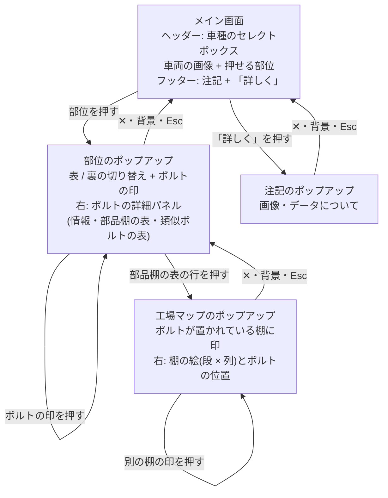

# 画面遷移図

iPad の横向きを基準に作っています。画面は、メイン画面 1 つと、その上に重なるポップアップ 3 つ(部位、工場マップ、画像・データの注記)で構成します。

工場マップは、ボルトのポップアップの上に重なります。閉じると、選んでいたボルトの表示のまま、ボルトのポップアップに戻ります。

## 使う API

| 画面 | API |
|---|---|
| メイン画面 | `GET /api/vehicles`、`GET /api/vehicles/{id}/parts` |
| 部位のポップアップ | `GET /api/vehicle-parts/{id}`(右のパネルは `GET /api/bolts/{id}`) |
| 工場マップのポップアップ | `GET /api/bolts/{id}`(棚の位置)、`GET /api/parts-shelves/{id}`(棚の絵) |

## 画面の決まり

- メイン画面は、スクロールなしで 1 画面に収める(1366 × 1024 と 1024 × 768 で確認)
- 車両の部位は、最初から薄い枠で見せる。ボルトの印は、押す前は透明で、ボルトの絵をそのまま見せる。色が出るのは、ホバー(マウスのある端末だけ)・押している間・選択中
- ポップアップは、画面内に収める。閉じる操作は、右上の「✕」、背景を押す、Esc の 3 つ
- 部位のポップアップは、ボルトがある側(表 / 裏)を最初に出す
- ボルトの詳細パネルの高さは、左の画像の列に合わせて固定する。類似ボルトが多いときは、パネルの中だけがスクロールする
- 類似ボルトの表は、押せない(間違えて、似たボルトの詳細を開かないため)
- 部位がない車両は、「この車種の部位は、準備中です」と表示する
- 画像は、すべて AI 生成または draw.io で作った架空のもの。その注記を、画面の下に 1 行で表示し、「詳しく」で全文を出す
