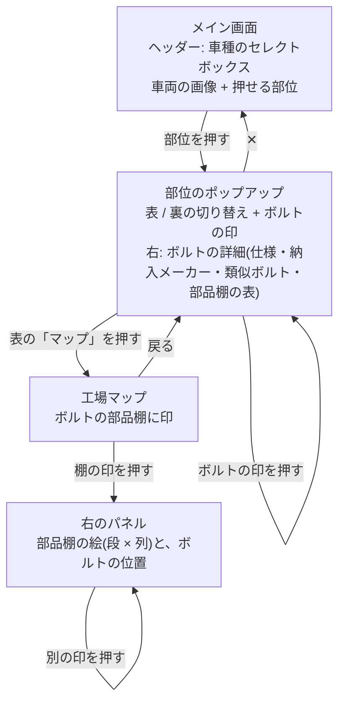

# 画面遷移図

iPad の横向きで使う想定です。画面は 2 つ(メイン、工場マップ)と、ポップアップ 1 つ(部位)で構成します。

## 使う API

| 画面 | API |
|---|---|
| メイン画面 | `GET /api/vehicles`、`GET /api/vehicles/{id}/parts` |
| 部位のポップアップ | `GET /api/vehicle-parts/{id}`、`GET /api/bolts/{id}` |
| 工場マップ + 右のパネル | `GET /api/bolts/{id}`(部品棚の位置)、`GET /api/parts-shelves/{id}` |

## 画面の決まり

- メイン画面は、スクロールなしで 1 画面に収める
- 押せる場所は、最初から薄い枠で見せる。ホバーで色が変わるのは、マウスのある端末だけ。タッチ端末では、押している間だけ色が変わる
- ポップアップは、右上の「✕」で閉じる
- 画像は、すべて AI 生成の架空のもの。その注記を、画面の下に 1 行で表示する
